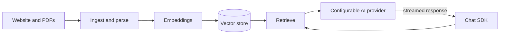
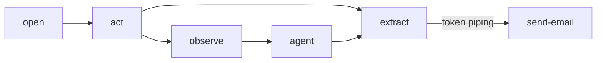
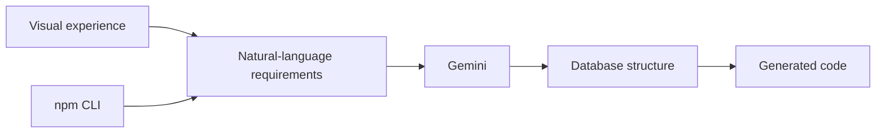
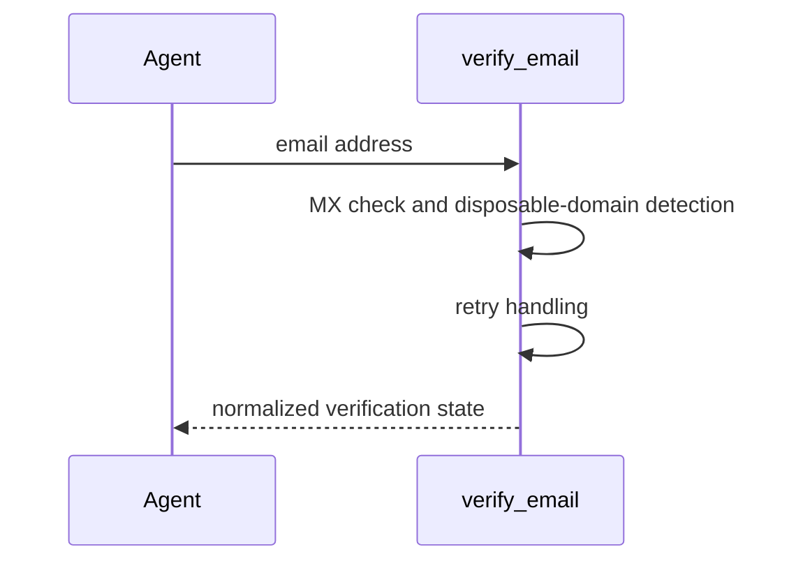
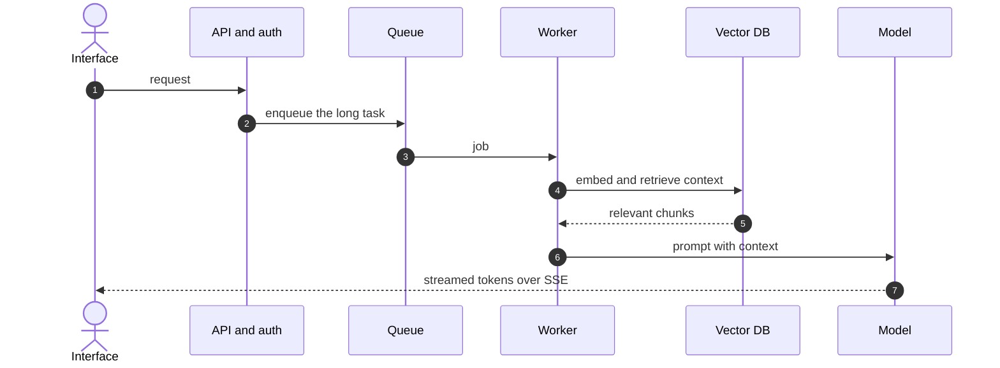
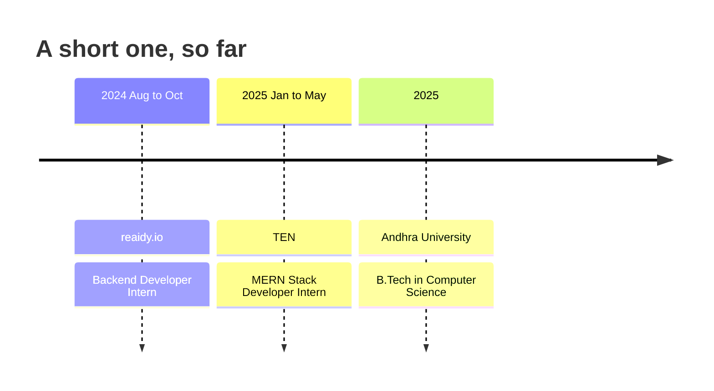

# Siddharth Reddy

**I build the things behind the interface.**

Backend systems · AI products · Agents · Automation · Developer tools

[Work](#selected-work) · [What I build](#what-i-build) · [Behind one request](#behind-one-request) · [Path](#path) · [Stack](#stack) · [Say hello](#say-hello)

> [!NOTE]
> **Now.** 2025 CSE graduate from Andhra University, based in India. Building agents, automation and developer tools, and usually one side project deep.

 

## Selected work

Four things I shipped. Open any card to see how it works.

### [BSDK](https://github.com/siddreddy07/bsdk)

*Give any website its own AI brain.* &nbsp;`SHIPPED`

An embeddable AI SDK backed by the infrastructure that makes website AI actually useful: website ingestion, PDF parsing, embeddings, vector retrieval, configurable AI providers, streaming responses and a customizable chat SDK.

`TypeScript` `Node.js` `MongoDB` `Pinecone` `Cohere`

[Live](https://bsdk.siddharthreddy627.workers.dev/) · [Source](https://github.com/siddreddy07/bsdk)

How it works

 

### [Auto Browse](https://github.com/siddreddy07/auto-browse)

*Build browser automations visually.* &nbsp;`SHIPPED`

A collaborative canvas where browser workflows are composed from `open`, `act`, `extract`, `observe`, `agent` and `send-email` nodes. Background executions, token piping, per-node outputs, validation, shared editing and replayable browser sessions.

`Next.js` `Stagehand` `Trigger.dev` `Neon`

[Live](https://auto-browse-seven.vercel.app/) · [Source](https://github.com/siddreddy07/auto-browse)

How it works

Workflows run in the background, each node keeps its own output, and every browser session can be replayed.

 

### [dbSmash](https://github.com/siddreddy07/dbsmash-CLI-npm-package)

*Describe it. Generate it. Use it.* &nbsp;`PUBLISHED ON NPM`

It started with one question: why am I writing the same database boilerplate again? dbSmash turns natural-language requirements into database structures and generated code, through a visual experience or an npm CLI.

`Node.js` `Gemini` `CLI`

[npm](https://www.npmjs.com/package/dbsmash) · [Source](https://github.com/siddreddy07/dbsmash-CLI-npm-package)

How it works

 

### [InboxValid MCP](https://github.com/siddreddy07/InboxValid-MCP-Server)

*Email verification, callable by agents.* &nbsp;`MCP SERVER`

An MCP server that exposes one structured `verify_email` tool: MX checks, disposable-domain detection, retry handling and normalized verification states. A small tool built around a useful primitive: agent → tool → verified result.

`TypeScript` `Node.js` `MCP`

[Source](https://github.com/siddreddy07/InboxValid-MCP-Server)

How it works

 

<b>Also built</b>

 

| Project | What it is | Built with |
|:--|:--|:--|
| **Personal AI Agent** | Document ingestion, embeddings, retrieval, tools and streamed responses. | `Vercel AI SDK` `Qdrant` `BullMQ` `PostgreSQL` `SSE` `React Native` |
| **Collaborative Code Editor** | Real-time Monaco editor with shared document state and user awareness. | `Yjs` `y-monaco` `Socket.io` |
| **MCP Twitter Server** | Tweet publishing exposed as a callable tool for AI agents. | `Node.js` `MCP` `X API` |
| **Shraddha Media** | Production news CMS with RBAC, Redis-backed OTP authentication and automated SEO and sitemap generation. | |

 

## What I build

| I build | What that means | Where I've done it |
|:--|:--|:--|
| **Backend systems** | Auth, queues, live updates, aggregation, rate limiting | Shraddha Media, TEN, reaidy.io |
| **AI products** | Ingestion, embeddings, retrieval, streamed answers | BSDK, Personal AI Agent |
| **Agents** | MCP servers and tool calling | InboxValid MCP, MCP Twitter Server |
| **Automation** | Browser workflows and background jobs | Auto Browse |
| **Developer tools** | CLIs and SDKs, published to npm | dbSmash, BSDK |

 

## Behind one request

The API needs auth. The task takes too long, so it needs a queue. The UI needs live updates, so now there is SSE. The AI needs context, so suddenly there is an ingestion pipeline and a vector database. That is usually where it gets interesting for me.

 

## Path

| When | Where | What I did |
|:--|:--|:--|
| Jan to May 2025 | **TEN**, MERN Stack Developer Intern | HRMS backend and a React e-commerce app. Employee APIs, role and access flows, attendance aggregation, reusable validation, cart, wishlist and filtering. |
| Aug to Oct 2024 | **reaidy.io**, Backend Developer Intern | Express and MongoDB. Leaderboard aggregation, interview scheduling, authentication, rate limiting and fewer unnecessary database round trips. |

 

## Stack

Not everything I've touched. Just what keeps showing up.

| Layer | Tools |
|:--|:--|
| **Backend** | `Node.js` `TypeScript` `Express` `Socket.io` `BullMQ` |
| **Data** | `PostgreSQL` `MongoDB` `Redis` `Drizzle` `Qdrant` |
| **AI and agents** | `Vercel AI SDK` `Gemini` `Groq` `Pinecone` `Cohere` `LangChain` |
| **Web** | `React` `Next.js` `Tailwind` `shadcn/ui` |
| **Infra** | `Docker` `AWS` `Vercel` `Trigger.dev` |

 

## Say hello

> [!TIP]
> If there is an interesting technical problem hiding under a simple interface, I would like to hear about it.

[Portfolio](https://siddharth-portfolio-delta.vercel.app/) · [LinkedIn](https://www.linkedin.com/in/n-siddharth-reddy/) · [npm](https://www.npmjs.com/package/dbsmash) · [siddharthreddy627@gmail.com](mailto:siddharthreddy627@gmail.com)

build something → learn something → build the next thing

