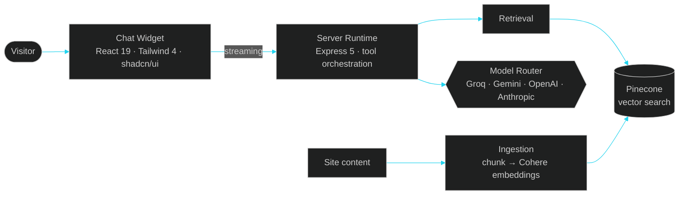
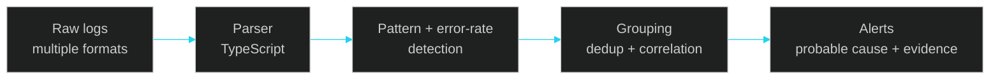

  

 

 

## ◈ &nbsp;TRANSMISSION

> **I build backends that hold up, and the products that sit on top of them.**

I'm a backend-first full-stack developer. I like the part of a product you don't see: API design, data retrieval, queues, caching, and the reliability work that keeps it all running. Lately that means **LLM applications, RAG pipelines and agentic workflows**, shipped as real products rather than demos.

<table>
<tr>
<td width="50%" valign="top">

**▸ Currently**
- Shipping independent products
- Building RAG + tool-calling systems
- Designing SDKs other developers can drop in

</td>
<td width="50%" valign="top">

**▸ Principles**
- Learn by implementation
- Solve real engineering problems
- Ship, then iterate

</td>
</tr>
</table>

 

 

## ◈ &nbsp;STACK

 

 

| Layer | What I work with |
|:--|:--|
| **Backend** | `Node.js` · `Express` · `REST` · `JWT` · `OAuth` · `RBAC` · `WebSockets` · `Streaming` · `BullMQ` |
| **Frontend** | `React` · `Next.js` · `Tailwind CSS` · `shadcn/ui` |
| **Data** | `PostgreSQL` · `MongoDB` · `Redis` · `Prisma` · `Drizzle ORM` · `Vector DBs` |
| **AI** | `RAG` · `Embeddings` · `Vector Search` · `AI Agents` · `Tool Calling` · `Vercel AI SDK` · `LangChain` |
| **Ship** | `Docker` · `AWS` · `Vercel` · `GitHub` · `pnpm` · `Postman` |

 

 

## ◈ &nbsp;FLAGSHIP

# ⚡ BSDK

### The chat SDK for AI-native websites

*An embeddable AI chat widget that answers visitor questions from a site's own content.*

 

 

<table>
<tr>
<td width="50%" valign="top">

**▸ Architecture**

| | |
|:--|:--|
| Monorepo | pnpm + Turborepo |
| UI SDK | React 19, Tailwind 4, shadcn/ui |
| Runtime | Streaming, retrieval, tools |
| Knowledge | Ingestion, chunking, embeddings |
| Vectors | Pinecone + Cohere |
| Models | Groq, Gemini, OpenAI, Anthropic |
| API | Express 5 + MongoDB |

</td>
<td width="50%" valign="top">

**▸ What I built**
- An embeddable chat experience
- A streaming backend runtime
- Document retrieval over a site's own knowledge
- Tool integration across multiple model providers
- Clean package split: UI, server runtime, CLI, playground
- Compatibility with Vercel AI SDK models

</td>
</tr>
</table>

 

 

# 🔍 Intelligent Log Analyzer

### Fewer alerts. Better alerts.

*Base14 Product Engineer take-home assignment*

 

A log analysis and alert generation system that finds meaningful patterns in application logs and cuts alert noise.

- **Parse** multiple log formats with TypeScript
- **Detect** patterns and error-rate spikes across configurable windows and thresholds
- **Correlate** related findings into incidents
- **Reduce noise** through grouping and deduplication
- **Explain** every alert with probable causes and supporting evidence

`Node.js` · `TypeScript` · `Express` · `YAML`

 

 

## ◈ &nbsp;EXPLORING

| Area | Focus |
|:--|:--|
| 🛠 **Backend Engineering** | API architecture, scalability, queues, caching |
| 🤖 **AI Engineering** | RAG, agent workflows, tool orchestration |
| 🗄 **Data Systems** | Redis, PostgreSQL, MongoDB, vector search |
| 📦 **Developer Experience** | SDKs, reusable packages, CLI tooling |
| 🧭 **System Design** | Reliability, observability, distributed workflows |

 

  

**`Curiosity  →  Code  →  Experiments  →  Better Systems`**

